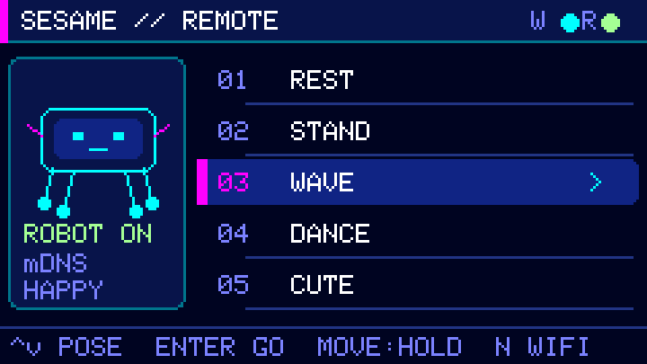
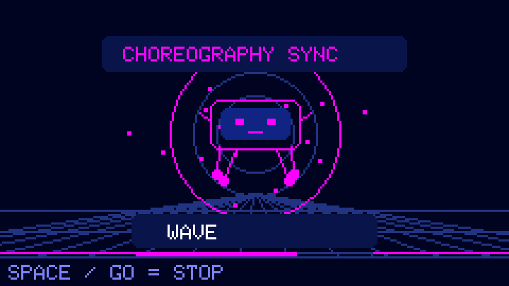
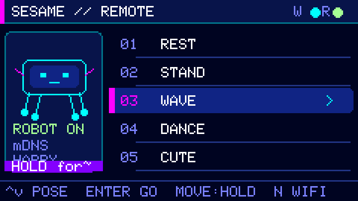
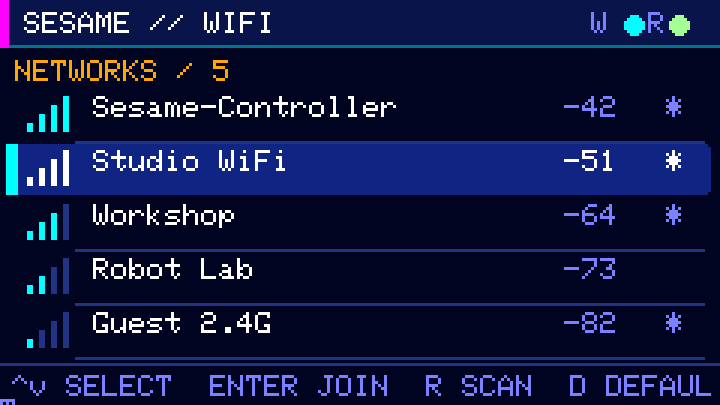
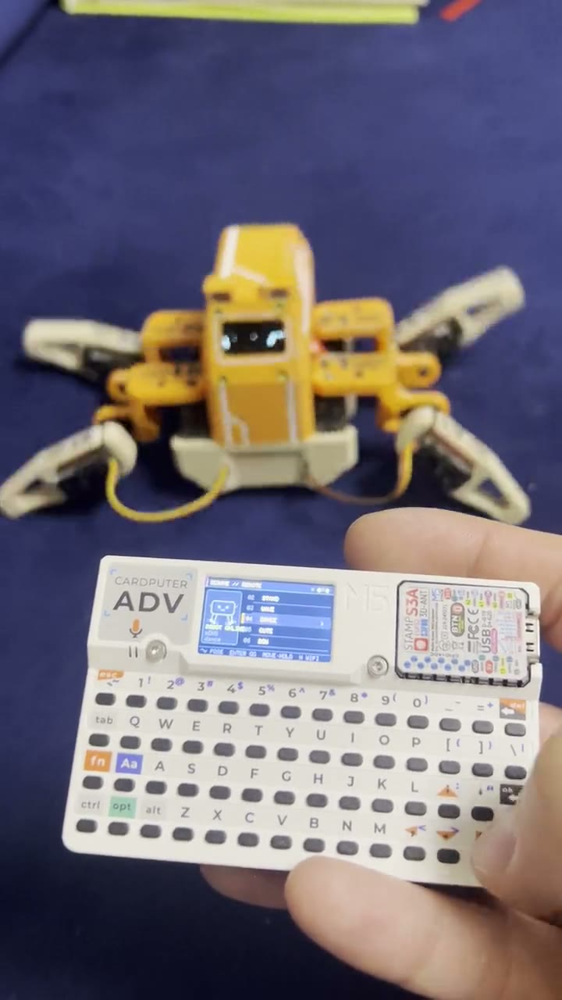

# Sesame Robot Remote for Cardputer

A Wi-Fi controller for the **M5Stack Cardputer ADV** that discovers and
controls a Sesame quadruped robot. It is packaged as an application-only
ESP32-S3 image for installation through M5Apps.

This controller targets the [original Sesame robot project](https://github.com/dorianborian/sesame-robot).

## Firmware screens

| Pose control | Choreography launch |
| --- | --- |
|  |  |
| **Hold to move** | **Wi-Fi selection** |
|  |  |

These are deterministic 240×135 captures from the shipping `src/main.cpp`
drawing code through M5GFX's desktop backend—not browser recreations. See the
[capture notes](docs/media/screens/README.md).

## Hardware test

<a href="docs/media/video/cardputer-control-sesame.mp4">
  
</a>

[Watch the 70-second Cardputer + Sesame hardware test](docs/media/video/cardputer-control-sesame.mp4)
— real Wi-Fi control, pose selection, and movement on the physical robot. The
recording predates the compact `ROBOT ON` status-label adjustment shown in the
current firmware screenshots.

## Project site

The static project site lives in [`docs/`](docs/) and is ready for GitHub
Pages. A workflow in [`.github/workflows/pages.yml`](.github/workflows/pages.yml)
publishes it automatically after a push to `main` once GitHub Pages is set to
use GitHub Actions.

## Experience

- Tries the robot's default access point first:
  `Sesame-Controller` / `12345678`.
- Searches for `sesame-robot.local` through mDNS after every Wi-Fi join.
- Falls back to the AP gateway (`192.168.4.1`) only on the default Sesame
  network, because the current robot firmware advertises mDNS only after it
  has joined a station network.
- Provides an on-device 2.4 GHz network scanner and password entry screen.
- Shows a neon launch animation before sending each selected pose.
- Moves while a WASD or arrow key is held, sends `stop` on release, and gives
  Space / the Go button an immediate stop action.
- Keeps entered Wi-Fi credentials in RAM only. It never initializes or erases
  the shared M5Apps NVS partition.

## Controls

| Key | Action |
| --- | --- |
| `;` / `.` | Previous / next pose |
| `,` / `/` | Jump one page backward / forward |
| Enter | Animate, then run the selected pose |
| `W A S D` or arrow keys | Move forward/left/back/right until released |
| Space or Go | Emergency stop |
| `N` | Scan and join another Wi-Fi network |
| `R` | Rediscover `sesame-robot.local` |
| Backtick | Back/cancel |
| Side Home button | Return to the M5Apps launcher |

The pose menu includes Rest, Stand, Wave, Dance, Cute, Bow, Shake, Shrug,
Point, Swim, Pushup, Crab, Worm, Freaky and Dead.

## Build

Install PlatformIO 6.2.0 (`python -m pip install platformio==6.2.0`), then run:

```sh
pio run -e cardputer-adv-sesame
python3 tools/build_release.py
```

To regenerate the checked-in firmware screenshots (SDL2 required), run:

```sh
python3 sim/render_docs.py
```

The pinned stack is PlatformIO `espressif32@7.1.3`, M5Unified `0.2.25`,
M5GFX `0.2.32`, M5Cardputer `1.2.0`, and its IRremote dependency `4.7.1`.
The native renderer pins `native@1.2.1`.

The release command creates an allowlisted package under `dist/`. The BIN is
an application image, not a whole-device image. Use **M5Apps → Installer →
SD**; never flash it at address `0x000000`. See [installation](docs/INSTALL.md).

The initial v0.1.0 build was installed and byte-verified in a dedicated
`SesameRemote` slot on the connected development Cardputer. The slot was
created in the free flash left after BrokenSignal was deleted; existing apps
were preserved. Exact offsets, checksums, and recovery details are in
[the device installation record](docs/DEVICE_INSTALL.md).

## Automated verification

Run `python -m unittest discover -s tests -v`. The Python-standard-library
suite retains the screenshot/video integrity checks and exercises the real
release validator and packager using temporary synthetic ESP32-S3 images.
Cases cover malformed headers and segments, descriptors/identity, checksum and
SHA-256 failures, trailing content, stale builds, canonical artifact selection,
unsafe versions, archive allowlists and output hashes.

The read-only PR workflow also compiles the firmware, enforces the existing
`0x140000` application limit, validates the resulting image, and builds the
actual-source SDL renderer against fake hardware/network APIs. Rendered
scenarios must exit cleanly and match the checked-in screenshot hashes across
three fresh processes (`python tools/check_renderer.py`, after the native build).
The renderer requests SDL shutdown and lets its owner join the worker, avoiding
a crash caused by process exit from the capture thread. No job flashes a
device, contacts a robot, publishes a release or deploys Pages.

A compile and simulated checks do not certify physical keyboard, Wi-Fi/mDNS,
stop-on-release, or M5Apps installation behavior. The earlier device/video
verification remains historical and does not certify a new dependency build.

## Robot compatibility

The controller expects the current Sesame firmware endpoints:

- `GET /api/status`
- `POST /api/command` with `{"command":"wave"}`

For LAN mDNS discovery, the robot and Cardputer must be on the same 2.4 GHz
network and the robot must have joined that network. Direct AP control works
without a router through the guarded gateway fallback.
